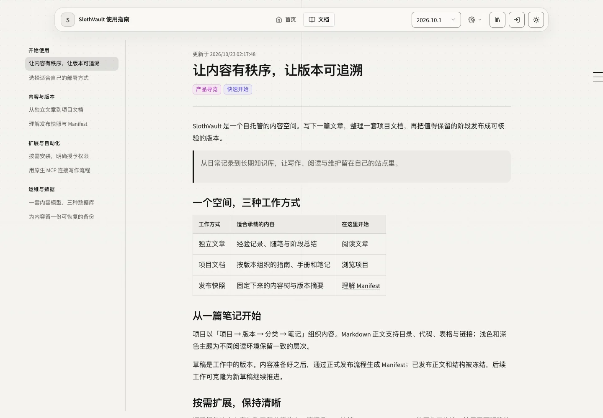
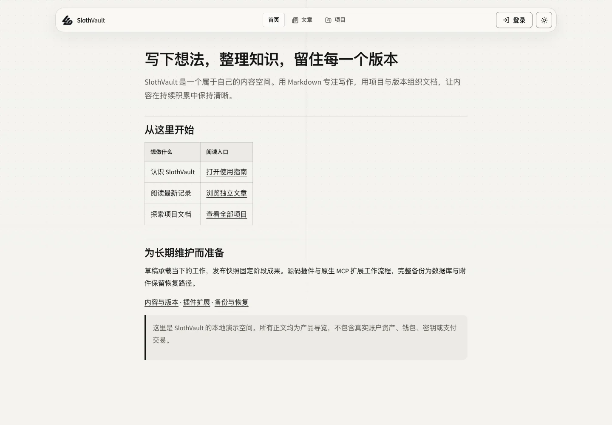
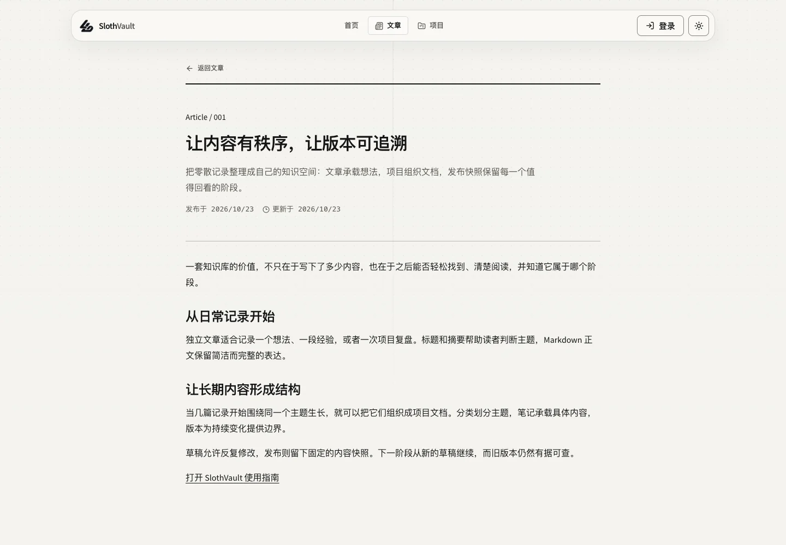
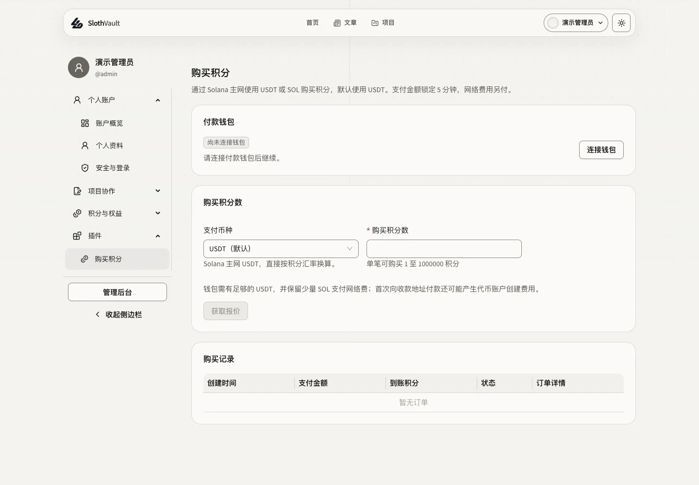
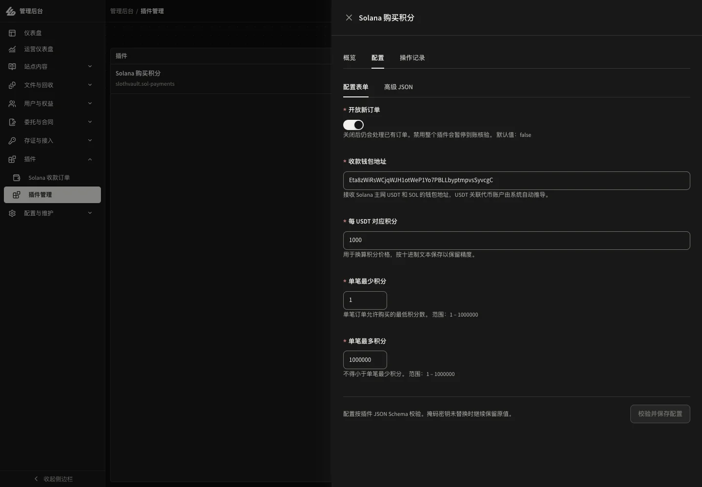
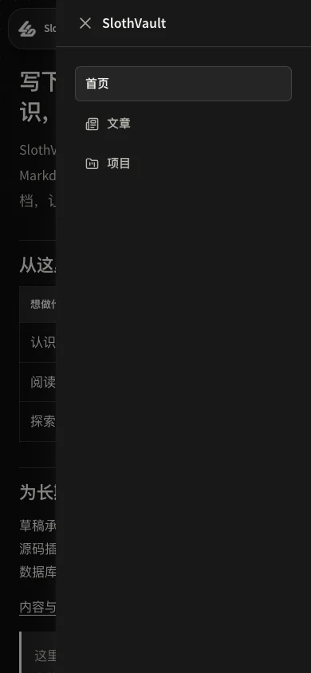
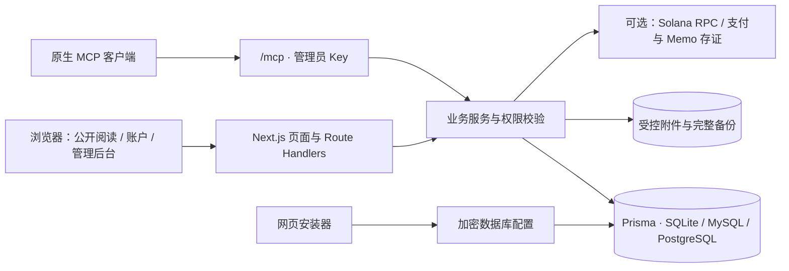

<div align="center">


# SlothVault

**让内容有秩序，让版本可追溯。**

面向独立写作、项目文档与版本存证的自托管内容系统。

[](https://github.com/holic512/SlothVault/actions/workflows/docker-build.yml)
[](./LICENSE)

[快速开始](#快速开始) · [界面预览](#界面预览) · [核心能力](#核心能力) · [部署指南](./integrations/deployment/README.md) · [文档导航](#文档导航)

</div>

<p align="center">
  <picture>
    <source media="(prefers-color-scheme: dark)" srcset="./docs/assets/screenshots/2026-10-23/project-docs-dark.webp" />
    
  </picture>
</p>

<p align="center">
  同一份项目文档 · <a href="./docs/assets/screenshots/2026-10-23/project-docs-light.webp">明亮主题</a> · <a href="./docs/assets/screenshots/2026-10-23/project-docs-dark.webp">暗黑主题</a>
</p>

> 真实界面，演示内容。截图更新于 **2026-10-23**，基于 **2.7.9** 的隔离本地实例，展示当前单色编辑风格、明暗主题与分组导航。顶部预览随阅读环境的明暗偏好切换；截图不包含真实业务数据或链上交易。来源与规格见[截图说明](./docs/assets/screenshots/2026-10-23/README.md)。

## 为什么是 SlothVault

SlothVault 将日常写作与长期维护的项目资料放在同一站点：文章按篇发布，项目文档按版本组织。你可以先完成内容发布，再按需添加公开可核验的版本存证，而不必让读者安装或连接钱包。

- **写作与文档各得其所**：独立 Markdown 文章用于记录与分享；项目、版本、分类与笔记承载成体系的资料。
- **草稿可以迭代，发布版本保持冻结**：校验文档树后生成发布快照与 Manifest v3，后续更新在新版本中继续。
- **数据与部署由自己掌握**：选择 SQLite、MySQL 或 PostgreSQL，使用网页安装器、自托管附件和完整备份。
- **管理不止于内容**：会员访问、积分账本、委托交付与管理员 MCP；按需安装卡密、Solana 购分等插件。

## 界面预览

### 公开阅读，从首页到正文

<p align="center">
  
</p>

<table>
  <tr>
    <td width="50%"></td>
    <td width="50%"></td>
  </tr>
  <tr>
    <td align="center"><strong>文章归档</strong><br />以文章为单位记录、发布与分享</td>
    <td align="center"><strong>专注阅读</strong><br />Markdown 正文与清晰的内容层级</td>
  </tr>
</table>

### 账户与后台，按职责组织操作

<table>
  <tr>
    <td width="50%"></td>
    <td width="50%"></td>
  </tr>
  <tr>
    <td align="center"><strong>账户工作区 · 明亮</strong><br />插件入口融入导航，USDT 为默认购分币种</td>
    <td align="center"><strong>插件管理 · 暗黑</strong><br />可视化配置、校验与独立插件管理</td>
  </tr>
</table>

账户与管理后台分别记住导航分组的折叠偏好，并自动展开当前页面所在分组；手机端通过抽屉浏览导航。

<p align="center">
  
</p>

截图使用示例内容与本地测试管理员，首页可由管理员编辑；账户、后台与受限内容需要对应身份授权。购分截图停留在钱包未连接状态，配置中的收款地址仅为演示公钥。

## 快速开始

### 本地运行

需要 **Node.js ≥ 24.22.1**；npm 版本以 [`package.json`](./package.json) 的 `packageManager` 为准。使用 SQLite 开发无需 Docker，也无需另外安装数据库服务。

```bash
git clone https://github.com/holic512/SlothVault.git
cd SlothVault
npm ci
APP_DATA_PATH=./data UPLOAD_STORAGE_PATH=./data/uploads npm run dev
```

打开 **[http://localhost:3000/install](http://localhost:3000/install)**，按安装器完成：

1. 选择 SQLite、MySQL 或 PostgreSQL。
2. 检查目标空库并初始化表结构。
3. 创建首位管理员，进入后台配置首页、文章或项目。

数据库连接由安装器加密保存；`DATABASE_URL` 与旧 `DB_*` 环境变量不能绕过安装流程。连接现有服务器数据库前，请先阅读[数据库安装与迁移指南](./docs/DATABASE_INSTALLATION.md)。

### Linux 部署

前置条件：**Docker Engine、Docker Compose v2、Python 3.10+**。部署程序不自动安装 Docker；发布镜像支持 `linux/amd64` 与 `linux/arm64`。

通过 SlothTool 安装并运行独立部署包：

```bash
npm install -g @holic512/slothtool
slothtool install slothvault
sudo env HOME="$HOME" "$(command -v slothtool)" slothvault deploy
```

也可以在源码目录直接执行 `sudo python3 integrations/deployment/install.py`，不依赖 SlothTool。程序交互选择数据库，默认生成 `/data/slothvault/compose.yml` 并启动应用；首次 schema 初始化完成后，再访问站点的 `/install` 创建管理员。

| 持久化内容 | 默认位置 |
| --- | --- |
| 应用配置、上传文件与 SQLite 数据 | `/data/slothvault/data` |
| MySQL 数据（选择该模式时） | `/data/slothvault/mysql` |
| PostgreSQL 数据（选择该模式时） | `/data/slothvault/postgresql` |

完整的 Nginx、HTTPS、更新与排错步骤集中在[部署指南](./integrations/deployment/README.md)。仓库内的三份 `docker-compose*.yml` 保留用于源码构建和本地开发，安装与目录隔离规则见[数据库指南](./docs/DATABASE_INSTALLATION.md)。

> **部署前请注意**：持久化数据目录与加密密钥必须一并保护；不要把上传文件放入 `public/`。当前短期挑战与限流使用进程内状态，不能将多个应用副本直接当作已支持的高可用部署。

## 核心能力

| 能力 | 当前实现 |
| --- | --- |
| **文章发布** | 独立 Markdown 文章、摘要、封面、归档、正文图片与受控下载附件。 |
| **项目文档** | 项目 → 版本 → 分类 → 笔记；正文历史、主版本、标签、项目首页与菜单。 |
| **版本发布** | 发布前文档树校验、不可变快照、紧凑 Manifest v3、完整性校验与受权限控制的 Manifest 下载。 |
| **公开阅读** | 中文与英文界面、明亮与暗黑主题、单色编辑与标准界面风格、标准与液态玻璃卡片；移动端抽屉导航。公开内容无需连接钱包。 |
| **账户与权益** | 密码登录、可选 Solana 钱包签名登录、多钱包绑定、资料与安全设置、并列会员类型、内容访问权限。 |
| **积分与购分** | 宿主管理积分余额、不可变流水与管理员调整；卡密插件提供批量发行和一次性兑换，Solana 支付插件默认使用 USDT 购分。 |
| **插件扩展** | 独立源码插件、配置表单与高级 JSON、更新检查和安装预览；安装与更新前明确确认信任，按插件授予权限。 |
| **工作区导航** | 账户与后台按职责分组，可折叠侧栏、持久化分组偏好，自动展开当前页面所属分组。 |
| **委托与交付** | 需求记录、合同模板与版本、付款计划、交付、验收、维护及不可变提交记录。 |
| **管理与恢复** | 内容回收站、文件、用户、系统设置、运行观测、完整备份、恢复预检与任务历史。 |
| **自动化** | 管理员原生 MCP、项目文档索引与正文批读、带修订号的原子草稿批写，以及独立发布的 Skill。 |

### 内容如何组织

```text
站点
├── 首页                         管理员维护的 Markdown 入口
├── 独立文章                     按篇发布，可继续编辑
└── 项目
    ├── 项目首页与菜单
    └── 版本                     草稿可编辑，发布后正文冻结
        └── 分类
            └── 笔记             标签与正文历史
                └── 主正文       发布校验与内容哈希的来源
```

访客阅读公开文章和项目；注册用户拥有账户、安全、积分、会员与委托工作区；管理员负责内容、用户、备份和系统管理。会员限制由文章允许名单、项目阅读权限及下载权限共同定义，不以展示排序推断权限，详见[会员与项目访问](./docs/MEMBERSHIP_PROJECT_ACCESS.md)。

### 按需扩展积分交易

积分账本由宿主管理，购分与卡密功能由独立插件提供。管理员在插件管理中预览安装包、确认信任、填写配置并启用插件，相关入口随后出现在账户或后台导航中；发现更新后可查看预览并手动确认安装。

**Solana 购买积分**插件以 **USDT 为首选**，也可选择 SOL，**仅支持 Solana Mainnet**。管理员配置收款钱包、每 USDT 对应积分和订单范围；用户连接钱包获取报价，再确认付款。服务端核验实际链上到账后，才记入积分账本。

安装、持久化与备份说明见[插件运维指南](./docs/plugins/operations.md)；支付配置与到账校验见[Solana 支付插件](./plugins/sol-payments/README.md)。

### 可选存证，而非阅读前提

内容发布与链上存证相互独立。管理员可为已发布项目版本发送一笔 Solana Memo 交易，绑定 Manifest v3 的 `releaseHash` 与正文树聚合 `contentHash`；正文不写入链上。同一发布版本在每个网络最多保留一条最终凭证。

- 存证支持 **Mainnet** 与 **Devnet**，Devnet 当前仅允许 Phantom；这里的网络选择仅适用于存证，购分支付固定使用 Mainnet。
- 版本菜单提供凭证查看与 Manifest 下载；公开版本凭证路由为 `/evidence/<transactionSignature>`。
- 委托记录保留独立的提交与存证流程，不与项目版本凭证混用。
- 存证不代表 NFT、版权归属或可转移资产，也不免除正常链上手续费。

完整的哈希规则、校验边界与可见性约束见 [Manifest v3 规范](./docs/RELEASE_MANIFEST_V3.md)；委托流程见[委托工作区说明](./plugins/commissions/README.md)。

## 管理员 MCP 与项目文档维护

内置 Streamable HTTP 入口 **`/mcp`** 使用可撤销的管理员 MCP Key 鉴权，不复用网页 Cookie。当前产品支持 **Codex、Claude Code 自带的原生 MCP 客户端**直连；SlothTool 只负责可选的 Skill 管理与部署，不参与 MCP 连接或工具调用。

项目文档工作流可以从源码建立文档，或在保留历史发布版本的前提下增量更新：

1. 检查源码和已有文档，确定本次变更范围。
2. 为新版本复制上一版本的完整文档树，再修订受影响内容。
3. 用稳定文档键、源码基线与修订号追踪草稿更新，维护集中更新日志。
4. 校验草稿后交由管理员在明确授权下发布；默认不自动发布或改变权限。

实际工具以[代码生成的 MCP Registry](./docs/MCP_REGISTRY.md)和宿主发现结果为准，避免依赖 README 中容易过期的工具数量或包版本。

- [管理员 MCP 接入](./docs/MCP_ADMIN.md)：Key、鉴权与原生连接说明。
- [Skill 项目文档工作流](./integrations/skill/slothvault-mcp/references/project-documentation.md)：文档生成、增量更新与发布边界。
- [独立 Skill](./integrations/skill/README.md) · [Deployment Package](./integrations/deployment/README.md) · [集成职责边界](./integrations/ARCHITECTURE.md)。

## 架构与数据安全

基于 **Next.js 16 App Router、React 19、TypeScript 与 Prisma 7**。三种 SQL 数据库按安装配置择一使用，不要求同时部署。



SQL 数据库是账户、Session、积分、插件业务数据与存证索引的权威来源；进程内 TTL 状态只承担一次性钱包挑战和短期限流。钱包登录验证地址所有权，不发起交易，也不保存私钥；购分付款与版本存证分别需要用户确认并签署交易。

### 常用配置

| 配置 | 用途与默认值 |
| --- | --- |
| `APP_DATA_PATH` | 配置和 SQLite 根目录；本地默认 `./data`，容器使用 `/app/data`。 |
| `UPLOAD_STORAGE_PATH` | 受控上传目录；本地默认 `./data/uploads`，容器使用 `/app/data/uploads`。 |
| `BACKUP_STORAGE_PATH` | 完整备份目录；默认 `${APP_DATA_PATH}/backups`，可挂载独立磁盘。 |
| `BACKUP_DATABASE_TRANSACTION_TIMEOUT_MS` | 备份与恢复的数据库事务超时；默认 `3600000` 毫秒，不含压缩、传输和预检。 |
| `ENCRYPTION_KEY` | 配置加密主密钥；未配置时在应用配置目录生成并持久化。 |
| `SOLANA_RPC_URL` / `SOLANA_DEVNET_RPC_URL` | 对应网络主 RPC 的环境回退值；可在后台管理节点。 |
| `SOLANA_MAINNET_RPC_FALLBACK` / `SOLANA_DEVNET_RPC_FALLBACK` | 对应网络的备用 RPC。 |
| `NEXT_PUBLIC_SOLANA_RPC_URL` | 浏览器钱包使用的公共集群地址，不应包含私密凭据。 |

### 备份与恢复

后台提供包含数据库与附件的 ZIP64 完整备份、恢复预检、恢复前保护备份和任务历史。自动备份默认关闭；启用后的默认计划为每天 **Asia/Shanghai 03:00**，保留 **7** 份成功自动备份。支持分片上传续传与 HTTP Range 下载。

备份可能包含密码哈希、个人资料、会员权限与业务记录，必须按敏感数据保管；加密密钥也应独立妥善保存。覆盖范围、格式兼容与恢复中断处理见[完整备份与恢复](./docs/BACKUP_AND_RESTORE.md)。

## 开发与验证

```text
src/
├── app/                     页面、布局、API 与 MCP 入口
├── components/              阅读、账户与后台交互组件
├── server/                  业务服务、鉴权、数据库、MCP 与运行时
├── i18n/                    国际化配置
└── styles/                  样式与主题
prisma/providers/            SQLite / MySQL / PostgreSQL schema 与迁移
plugins/                     独立源码插件与 SDK
integrations/                独立 Skill、部署包与集成协议
tests/visual/                代表性页面视觉基准
docs/                        安装、权限、备份、存证与发布指南
```

按改动选择最小充分检查，不默认执行全量测试和生产构建：

| 命令 | 用途 |
| --- | --- |
| `npm run lint:styles` | 样式检查。 |
| `npm run lint` | ESLint 检查。 |
| `npm run typecheck` | TypeScript 类型检查。 |
| `npm test -- <测试文件>` | 运行直接相关的 Vitest 测试。 |
| `npm run verify:plugins` | 与 CI 共用的插件打包、发布契约、类型及生命周期检查；默认 SQLite，配置测试数据库 URL 后同时验证 MySQL / PostgreSQL。 |
| `npm run test:visual` | 运行既有代表性视觉回归。 |
| `npm run mcp:docs:check` | 核对 MCP 文档与工具声明。 |
| `npm run build` | 需要验证生产打包时执行。 |

应用、Skill 与 Deployment 按各自发布单元管理。准备提交时遵循仓库的版本规则；版本文件与发布记录应在提交前同步，不由 CI 回写 Git 历史。详见[开发规则](./AGENTS.md)与[发布流程](./docs/releasing.md)。

插件或数据库兼容性变更应执行 `npm run verify:plugins`。三库测试使用专用本地服务，通过 `SLOTHVAULT_PLUGIN_TEST_MYSQL_URL` 与 `SLOTHVAULT_PLUGIN_TEST_POSTGRESQL_URL` 配置；测试自行创建并删除随机命名的临时库。未配置时，相应分支会跳过，SQLite 通过不代表三库均通过。涉及源码冷编译、Worker 重启和重装的集成测试按套件设置有界时限，不通过自动重试掩盖失败。

## 文档导航

| 你想做什么 | 从这里开始 |
| --- | --- |
| 安装或迁移数据库 | [数据库安装与迁移](./docs/DATABASE_INSTALLATION.md) |
| 在 Linux 部署、配置 Nginx / HTTPS 或更新 | [Deployment 部署指南](./integrations/deployment/README.md) |
| 管理会员、阅读与下载权限 | [会员与项目访问](./docs/MEMBERSHIP_PROJECT_ACCESS.md) |
| 安装插件、管理插件数据与备份 | [插件运维指南](./docs/plugins/operations.md) |
| 配置 Solana 主网 USDT / SOL 购分 | [Solana 支付插件](./plugins/sol-payments/README.md) |
| 管理委托、合同与交付 | [委托工作区](./plugins/commissions/README.md) |
| 备份、恢复或处理恢复中断 | [完整备份与恢复](./docs/BACKUP_AND_RESTORE.md) |
| 理解发布快照与存证哈希 | [Manifest v3](./docs/RELEASE_MANIFEST_V3.md) |
| 连接管理员 MCP、查看工具清单 | [接入说明](./docs/MCP_ADMIN.md) · [Registry](./docs/MCP_REGISTRY.md) |
| 通过智能体维护项目文档 | [Skill 工作流](./integrations/skill/slothvault-mcp/references/project-documentation.md) · [原生 MCP 工作流](./docs/SLOTHTOOL_MCP_WORKFLOW_GUIDE.md) |
| 理解运行统计与诊断边界 | [运行观测](./docs/telemetry.md) |
| 参与开发或准备发布 | [AGENTS.md](./AGENTS.md) · [发布流程](./docs/releasing.md) |

## 许可证

SlothVault 使用 [MIT License](./LICENSE)。第三方依赖与资产声明见 [THIRD_PARTY_NOTICES.md](./THIRD_PARTY_NOTICES.md)。
