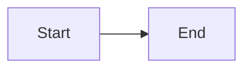

# Markdown extensions

<!-- Generated by scripts/generate-markdown-docs.mjs; edit the shared contract or this generator. -->

For advanced content, discover content.markdown.capabilities (optionally extensionId) once per server version, then use content.markdown.validate before saving. Existing body tools accept the resulting Markdown string. A validation pass proves only static syntax/configuration, not rendered appearance or factual accuracy. If these tools are absent, use ordinary Markdown, existing Mermaid or static images. Never claim unsupported extensions work.

Upload images first and store returned original filePath URLs. The reader requests protected thumbnails; do not invent derivative paths or upload duplicates. Never execute document JavaScript. Preserve user authorization and draft/publication boundaries.

Schema refinements also enforce forbidden chart fields, supported series and aggregate data limits. See restrictions below; schemas alone do not replace the validator. Use sufficiently long colon fences around nested containers (tabs contains tab). Each direct child of columns occupies one column; use sections for multi-paragraph columns. Timeline and steps contain Markdown lists. Unknown/invalid blocks show a local diagnostic and escaped source.

## Capability contract

```json
{
  "version": "1.0.0",
  "limits": {
    "content": 500000,
    "block": 50000,
    "series": 10,
    "dataItems": 5000,
    "nesting": 6,
    "minHeight": 240,
    "maxHeight": 800,
    "minDuration": 100,
    "maxDuration": 2000,
    "maxDelay": 1000
  },
  "chartTypes": [
    "line",
    "bar",
    "pie",
    "scatter",
    "radar"
  ],
  "restrictions": [
    "JSON only; no functions, formatter, custom series, external resources, HTML dataView or links.",
    "Chart validation also enforces series/data limits and forbidden fields beyond JSON Schema."
  ],
  "images": {
    "thumbnail": "Managed images only; variant=markdown-thumbnail; WebP 1280px quality 80; first animation frame.",
    "original": "Store original URL; load on preview; identical current read authorization."
  },
  "extensions": [
    {
      "id": "echarts",
      "syntax": "fenced:echarts",
      "schema": {
        "$schema": "https://json-schema.org/draft/2020-12/schema",
        "type": "object",
        "properties": {
          "version": {
            "type": "number",
            "const": 1
          },
          "height": {
            "default": 360,
            "type": "integer",
            "minimum": 240,
            "maximum": 800
          },
          "caption": {
            "default": "",
            "type": "string",
            "maxLength": 500
          },
          "option": {
            "type": "object",
            "propertyNames": {
              "type": "string"
            },
            "additionalProperties": {}
          }
        },
        "required": [
          "version",
          "height",
          "caption",
          "option"
        ],
        "additionalProperties": false
      },
      "presets": [
        {
          "id": "line",
          "extension": "echarts",
          "category": "charts",
          "label": "line",
          "source": "```echarts\n{\n  \"version\": 1,\n  \"height\": 360,\n  \"caption\": \"Example data\",\n  \"option\": {\n    \"xAxis\": {\n      \"type\": \"category\",\n      \"data\": [\n        \"A\",\n        \"B\",\n        \"C\"\n      ]\n    },\n    \"yAxis\": {\n      \"type\": \"value\"\n    },\n    \"series\": [\n      {\n        \"type\": \"line\",\n        \"data\": [\n          20,\n          45,\n          32\n        ]\n      }\n    ]\n  }\n}\n```"
        },
        {
          "id": "area",
          "extension": "echarts",
          "category": "charts",
          "label": "area",
          "source": "```echarts\n{\n  \"version\": 1,\n  \"height\": 360,\n  \"caption\": \"Example data\",\n  \"option\": {\n    \"xAxis\": {\n      \"type\": \"category\",\n      \"data\": [\n        \"A\",\n        \"B\",\n        \"C\"\n      ]\n    },\n    \"yAxis\": {\n      \"type\": \"value\"\n    },\n    \"series\": [\n      {\n        \"type\": \"line\",\n        \"data\": [\n          20,\n          45,\n          32\n        ],\n        \"areaStyle\": {}\n      }\n    ]\n  }\n}\n```"
        },
        {
          "id": "bar",
          "extension": "echarts",
          "category": "charts",
          "label": "bar",
          "source": "```echarts\n{\n  \"version\": 1,\n  \"height\": 360,\n  \"caption\": \"Example data\",\n  \"option\": {\n    \"xAxis\": {\n      \"type\": \"category\",\n      \"data\": [\n        \"A\",\n        \"B\",\n        \"C\"\n      ]\n    },\n    \"yAxis\": {\n      \"type\": \"value\"\n    },\n    \"series\": [\n      {\n        \"type\": \"bar\",\n        \"data\": [\n          20,\n          45,\n          32\n        ]\n      }\n    ]\n  }\n}\n```"
        },
        {
          "id": "stacked",
          "extension": "echarts",
          "category": "charts",
          "label": "stacked",
          "source": "```echarts\n{\n  \"version\": 1,\n  \"height\": 360,\n  \"caption\": \"Example data\",\n  \"option\": {\n    \"xAxis\": {\n      \"type\": \"category\",\n      \"data\": [\n        \"A\",\n        \"B\",\n        \"C\"\n      ]\n    },\n    \"yAxis\": {\n      \"type\": \"value\"\n    },\n    \"series\": [\n      {\n        \"type\": \"bar\",\n        \"data\": [\n          20,\n          45,\n          32\n        ],\n        \"stack\": \"total\"\n      },\n      {\n        \"type\": \"bar\",\n        \"stack\": \"total\",\n        \"data\": [\n          12,\n          25,\n          18\n        ]\n      }\n    ]\n  }\n}\n```"
        },
        {
          "id": "pie",
          "extension": "echarts",
          "category": "charts",
          "label": "pie",
          "source": "```echarts\n{\n  \"version\": 1,\n  \"height\": 360,\n  \"caption\": \"Example data\",\n  \"option\": {\n    \"series\": [\n      {\n        \"type\": \"pie\",\n        \"data\": [\n          {\n            \"name\": \"A\",\n            \"value\": 40\n          },\n          {\n            \"name\": \"B\",\n            \"value\": 60\n          }\n        ]\n      }\n    ]\n  }\n}\n```"
        },
        {
          "id": "scatter",
          "extension": "echarts",
          "category": "charts",
          "label": "scatter",
          "source": "```echarts\n{\n  \"version\": 1,\n  \"height\": 360,\n  \"caption\": \"Example data\",\n  \"option\": {\n    \"xAxis\": {\n      \"type\": \"category\",\n      \"data\": [\n        \"A\",\n        \"B\",\n        \"C\"\n      ]\n    },\n    \"yAxis\": {\n      \"type\": \"value\"\n    },\n    \"series\": [\n      {\n        \"type\": \"scatter\",\n        \"data\": [\n          20,\n          45,\n          32\n        ]\n      }\n    ]\n  }\n}\n```"
        },
        {
          "id": "radar",
          "extension": "echarts",
          "category": "charts",
          "label": "radar",
          "source": "```echarts\n{\n  \"version\": 1,\n  \"height\": 360,\n  \"caption\": \"Example data\",\n  \"option\": {\n    \"radar\": {\n      \"indicator\": [\n        {\n          \"name\": \"A\",\n          \"max\": 100\n        },\n        {\n          \"name\": \"B\",\n          \"max\": 100\n        },\n        {\n          \"name\": \"C\",\n          \"max\": 100\n        }\n      ]\n    },\n    \"series\": [\n      {\n        \"type\": \"radar\",\n        \"data\": [\n          {\n            \"value\": [\n              50,\n              80,\n              65\n            ],\n            \"name\": \"Example\"\n          }\n        ]\n      }\n    ]\n  }\n}\n```"
        }
      ],
      "fallback": "Local diagnostic and escaped source; surrounding document remains readable."
    },
    {
      "id": "counter",
      "syntax": "fenced:counter",
      "schema": {
        "$schema": "https://json-schema.org/draft/2020-12/schema",
        "type": "object",
        "properties": {
          "version": {
            "type": "number",
            "const": 1
          },
          "title": {
            "type": "string",
            "maxLength": 200
          },
          "from": {
            "default": 0,
            "type": "number"
          },
          "to": {
            "type": "number"
          },
          "unit": {
            "default": "",
            "type": "string",
            "maxLength": 40
          },
          "precision": {
            "default": 0,
            "type": "integer",
            "minimum": 0,
            "maximum": 6
          },
          "duration": {
            "default": 900,
            "type": "integer",
            "minimum": 100,
            "maximum": 2000
          }
        },
        "required": [
          "version",
          "title",
          "from",
          "to",
          "unit",
          "precision",
          "duration"
        ],
        "additionalProperties": false
      },
      "presets": [
        {
          "id": "counter",
          "extension": "counter",
          "category": "motion",
          "label": "counter",
          "source": "```counter\n{\n  \"version\": 1,\n  \"title\": \"Example\",\n  \"from\": 0,\n  \"to\": 128,\n  \"unit\": \"\",\n  \"precision\": 0,\n  \"duration\": 900\n}\n```"
        }
      ],
      "fallback": "Local diagnostic and escaped source; surrounding document remains readable."
    },
    {
      "id": "motion",
      "syntax": "container:motion",
      "schema": {
        "$schema": "https://json-schema.org/draft/2020-12/schema",
        "type": "object",
        "properties": {
          "effect": {
            "default": "fade-up",
            "type": "string",
            "enum": [
              "fade",
              "fade-up",
              "stagger"
            ]
          },
          "duration": {
            "default": 600,
            "type": "integer",
            "minimum": 100,
            "maximum": 2000
          },
          "delay": {
            "default": 0,
            "type": "integer",
            "minimum": 0,
            "maximum": 1000
          }
        },
        "required": [
          "effect",
          "duration",
          "delay"
        ],
        "additionalProperties": false
      },
      "presets": [
        {
          "id": "fade",
          "extension": "motion",
          "category": "motion",
          "label": "fade",
          "source": ":::motion{effect=\"fade\" duration=\"600\" delay=\"0\"}\n\n{{selection}}\n\n:::"
        },
        {
          "id": "fade-up",
          "extension": "motion",
          "category": "motion",
          "label": "fade-up",
          "source": ":::motion{effect=\"fade-up\" duration=\"600\" delay=\"0\"}\n\n{{selection}}\n\n:::"
        },
        {
          "id": "stagger",
          "extension": "motion",
          "category": "motion",
          "label": "stagger",
          "source": ":::motion{effect=\"stagger\" duration=\"600\" delay=\"0\"}\n\n{{selection}}\n\n:::"
        }
      ],
      "fallback": "Local diagnostic and escaped source; surrounding document remains readable."
    },
    {
      "id": "callout",
      "syntax": "container:callout",
      "schema": {
        "$schema": "https://json-schema.org/draft/2020-12/schema",
        "type": "object",
        "properties": {
          "tone": {
            "default": "note",
            "type": "string",
            "enum": [
              "note",
              "warning",
              "success"
            ]
          }
        },
        "required": [
          "tone"
        ],
        "additionalProperties": false
      },
      "presets": [
        {
          "id": "callout",
          "extension": "callout",
          "category": "layout",
          "label": "callout",
          "source": ":::callout{tone=\"note\"}\n\n{{selection}}\n\n:::"
        }
      ],
      "fallback": "Local diagnostic and escaped source; surrounding document remains readable."
    },
    {
      "id": "details",
      "syntax": "container:details",
      "schema": {
        "$schema": "https://json-schema.org/draft/2020-12/schema",
        "type": "object",
        "properties": {
          "title": {
            "default": "Details",
            "type": "string",
            "maxLength": 200
          }
        },
        "required": [
          "title"
        ],
        "additionalProperties": false
      },
      "presets": [
        {
          "id": "details",
          "extension": "details",
          "category": "layout",
          "label": "details",
          "source": ":::details{title=\"Details\"}\n\n{{selection}}\n\n:::"
        }
      ],
      "fallback": "Local diagnostic and escaped source; surrounding document remains readable."
    },
    {
      "id": "columns",
      "syntax": "container:columns",
      "schema": {
        "$schema": "https://json-schema.org/draft/2020-12/schema",
        "type": "object",
        "properties": {
          "count": {
            "default": 2,
            "type": "integer",
            "minimum": 2,
            "maximum": 3
          }
        },
        "required": [
          "count"
        ],
        "additionalProperties": false
      },
      "presets": [
        {
          "id": "columns",
          "extension": "columns",
          "category": "layout",
          "label": "columns",
          "source": ":::columns{count=\"2\"}\n\n{{selection}}\n\nSecond column\n\n:::"
        }
      ],
      "fallback": "Local diagnostic and escaped source; surrounding document remains readable."
    },
    {
      "id": "timeline",
      "syntax": "container:timeline",
      "schema": {
        "$schema": "https://json-schema.org/draft/2020-12/schema",
        "type": "object",
        "properties": {},
        "additionalProperties": false
      },
      "presets": [
        {
          "id": "timeline",
          "extension": "timeline",
          "category": "layout",
          "label": "timeline",
          "source": ":::timeline\n\n- First milestone\n- Second milestone\n\n:::"
        }
      ],
      "fallback": "Local diagnostic and escaped source; surrounding document remains readable."
    },
    {
      "id": "steps",
      "syntax": "container:steps",
      "schema": {
        "$schema": "https://json-schema.org/draft/2020-12/schema",
        "type": "object",
        "properties": {},
        "additionalProperties": false
      },
      "presets": [
        {
          "id": "steps",
          "extension": "steps",
          "category": "layout",
          "label": "steps",
          "source": ":::steps\n\n1. First step\n2. Second step\n\n:::"
        }
      ],
      "fallback": "Local diagnostic and escaped source; surrounding document remains readable."
    },
    {
      "id": "tabs",
      "syntax": "container:tabs",
      "schema": {
        "$schema": "https://json-schema.org/draft/2020-12/schema",
        "type": "object",
        "properties": {},
        "additionalProperties": false
      },
      "presets": [
        {
          "id": "tabs",
          "extension": "tabs",
          "category": "layout",
          "label": "tabs",
          "source": "::::tabs\n\n:::tab{title=\"First\"}\n\n{{selection}}\n\n:::\n\n:::tab{title=\"Second\"}\n\nSecond panel\n\n:::\n\n::::"
        }
      ],
      "fallback": "Local diagnostic and escaped source; surrounding document remains readable."
    },
    {
      "id": "tab",
      "syntax": "container:tab",
      "schema": {
        "$schema": "https://json-schema.org/draft/2020-12/schema",
        "type": "object",
        "properties": {
          "title": {
            "type": "string",
            "minLength": 1,
            "maxLength": 100
          }
        },
        "required": [
          "title"
        ],
        "additionalProperties": false
      },
      "presets": [],
      "fallback": "Local diagnostic and escaped source; surrounding document remains readable."
    },
    {
      "id": "mermaid",
      "syntax": "fenced:mermaid",
      "schema": {
        "$schema": "https://json-schema.org/draft/2020-12/schema",
        "type": "string",
        "maxLength": 50000
      },
      "presets": [
        {
          "id": "mermaid",
          "extension": "mermaid",
          "category": "charts",
          "label": "mermaid",
          "source": "```mermaid\nflowchart LR\n  A[Start] --> B[End]\n```"
        }
      ],
      "fallback": "Escaped source on loading or failure."
    }
  ]
}
```

## Copyable presets

### line

Replace {{selection}} with Markdown body content.

`````text
```echarts
{
  "version": 1,
  "height": 360,
  "caption": "Example data",
  "option": {
    "xAxis": {
      "type": "category",
      "data": [
        "A",
        "B",
        "C"
      ]
    },
    "yAxis": {
      "type": "value"
    },
    "series": [
      {
        "type": "line",
        "data": [
          20,
          45,
          32
        ]
      }
    ]
  }
}
```
`````

### area

Replace {{selection}} with Markdown body content.

`````text
```echarts
{
  "version": 1,
  "height": 360,
  "caption": "Example data",
  "option": {
    "xAxis": {
      "type": "category",
      "data": [
        "A",
        "B",
        "C"
      ]
    },
    "yAxis": {
      "type": "value"
    },
    "series": [
      {
        "type": "line",
        "data": [
          20,
          45,
          32
        ],
        "areaStyle": {}
      }
    ]
  }
}
```
`````

### bar

Replace {{selection}} with Markdown body content.

`````text
```echarts
{
  "version": 1,
  "height": 360,
  "caption": "Example data",
  "option": {
    "xAxis": {
      "type": "category",
      "data": [
        "A",
        "B",
        "C"
      ]
    },
    "yAxis": {
      "type": "value"
    },
    "series": [
      {
        "type": "bar",
        "data": [
          20,
          45,
          32
        ]
      }
    ]
  }
}
```
`````

### stacked

Replace {{selection}} with Markdown body content.

`````text
```echarts
{
  "version": 1,
  "height": 360,
  "caption": "Example data",
  "option": {
    "xAxis": {
      "type": "category",
      "data": [
        "A",
        "B",
        "C"
      ]
    },
    "yAxis": {
      "type": "value"
    },
    "series": [
      {
        "type": "bar",
        "data": [
          20,
          45,
          32
        ],
        "stack": "total"
      },
      {
        "type": "bar",
        "stack": "total",
        "data": [
          12,
          25,
          18
        ]
      }
    ]
  }
}
```
`````

### pie

Replace {{selection}} with Markdown body content.

`````text
```echarts
{
  "version": 1,
  "height": 360,
  "caption": "Example data",
  "option": {
    "series": [
      {
        "type": "pie",
        "data": [
          {
            "name": "A",
            "value": 40
          },
          {
            "name": "B",
            "value": 60
          }
        ]
      }
    ]
  }
}
```
`````

### scatter

Replace {{selection}} with Markdown body content.

`````text
```echarts
{
  "version": 1,
  "height": 360,
  "caption": "Example data",
  "option": {
    "xAxis": {
      "type": "category",
      "data": [
        "A",
        "B",
        "C"
      ]
    },
    "yAxis": {
      "type": "value"
    },
    "series": [
      {
        "type": "scatter",
        "data": [
          20,
          45,
          32
        ]
      }
    ]
  }
}
```
`````

### radar

Replace {{selection}} with Markdown body content.

`````text
```echarts
{
  "version": 1,
  "height": 360,
  "caption": "Example data",
  "option": {
    "radar": {
      "indicator": [
        {
          "name": "A",
          "max": 100
        },
        {
          "name": "B",
          "max": 100
        },
        {
          "name": "C",
          "max": 100
        }
      ]
    },
    "series": [
      {
        "type": "radar",
        "data": [
          {
            "value": [
              50,
              80,
              65
            ],
            "name": "Example"
          }
        ]
      }
    ]
  }
}
```
`````

### counter

Replace {{selection}} with Markdown body content.

`````text
```counter
{
  "version": 1,
  "title": "Example",
  "from": 0,
  "to": 128,
  "unit": "",
  "precision": 0,
  "duration": 900
}
```
`````

### fade

Replace {{selection}} with Markdown body content.

`````text
:::motion{effect="fade" duration="600" delay="0"}

{{selection}}

:::
`````

### fade-up

Replace {{selection}} with Markdown body content.

`````text
:::motion{effect="fade-up" duration="600" delay="0"}

{{selection}}

:::
`````

### stagger

Replace {{selection}} with Markdown body content.

`````text
:::motion{effect="stagger" duration="600" delay="0"}

{{selection}}

:::
`````

### callout

Replace {{selection}} with Markdown body content.

`````text
:::callout{tone="note"}

{{selection}}

:::
`````

### details

Replace {{selection}} with Markdown body content.

`````text
:::details{title="Details"}

{{selection}}

:::
`````

### columns

Replace {{selection}} with Markdown body content.

`````text
:::columns{count="2"}

{{selection}}

Second column

:::
`````

### timeline

Replace {{selection}} with Markdown body content.

`````text
:::timeline

- First milestone
- Second milestone

:::
`````

### steps

Replace {{selection}} with Markdown body content.

`````text
:::steps

1. First step
2. Second step

:::
`````

### tabs

Replace {{selection}} with Markdown body content.

`````text
::::tabs

:::tab{title="First"}

{{selection}}

:::

:::tab{title="Second"}

Second panel

:::

::::
`````

### mermaid

Replace {{selection}} with Markdown body content.

`````text

`````
